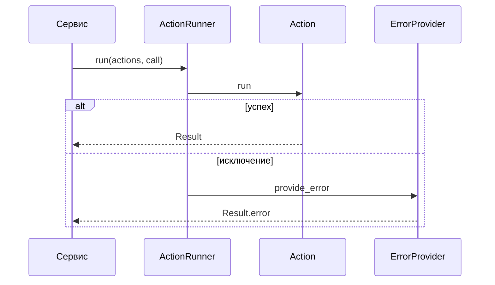

## Описание

`pymvc` (`mybootstrap_mvc_itskovichanton`) — MVC без привязки к веб-фреймворку. `Action` — один шаг, `ActionRunner` проводит цепочку над `Call` и собирает `Result` либо ошибку через `ErrorProvider` и алерты. Рядом лежат `CoreException` и `ResultPresenter`. HTTP и базу подключают соседние пакеты.

## Процедуры БД

Процедур базы данных в пакете нет.

## Схема работы

## Сценарии

### Прогон действия

1. Сервис вызывает `ActionRunner.run` и передаёт действия и `Call`.
2. Бегун вызывает `Action.run`. Результат шага становится входом следующего действия в цепочке.
3. Шаг завершился — вызывающему возвращается `Result`.
4. Шаг выбросил исключение — алерт, `ErrorProvider.provide_error`, в ответе `Result.error`, цепочка останавливается.

# Python app-bootstrap engine

MVC pattern classes are placed in this package